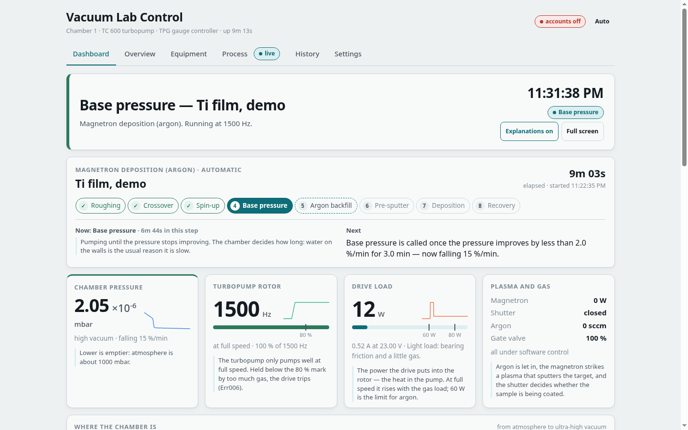
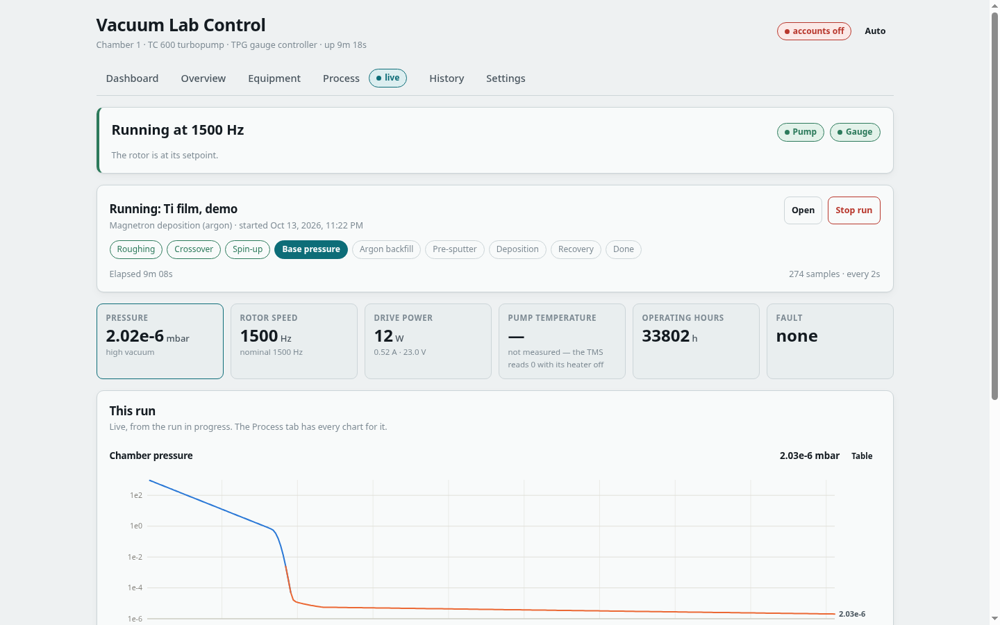
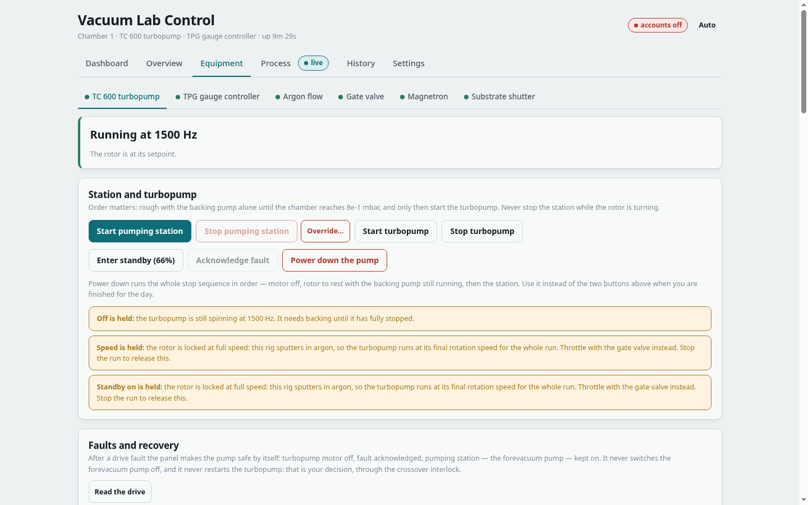

<h1 align="center">Vacuum Lab: control software for thin-film vacuum chambers</h1>
<div align="center">

<i>Native Linux control and automation of a magnetron sputter deposition rig — a Pfeiffer TC 600 turbopump and a TPG 252 A gauge controller driven over serial, a recipe engine with interlocks, a database of every run, a web panel for any screen, and a locked-down Android tablet as the lab's touch display.</i>

<br><br>

<a href="https://github.com/EARodriguezM/vacuum-lab/commits/main"></a>
<a href="https://github.com/EARodriguezM/vacuum-lab/issues"></a>
<a href="LICENSE"></a>


</div>

---

> This repository holds everything needed to run the lab's vacuum chambers
> from an ordinary, offline Linux PC: the instrument drivers, the control
> software and its web panel, the touch tablet that sits next to the rig, and
> the manuals the drivers were written from. No vendor runtime, no Windows,
> no LabVIEW, nothing to install from the internet at deploy time.
>
> **Status:** in daily use on chamber 1 (magnetron sputtering, argon). A
> second chamber, without a TC 600, is being prepared.



<p align="center"><i>The Dashboard during a deposition, in the built-in simulator: where the run is, what ends the current step and when, and the curves with the run's phases and limits.</i></p>

---

### Release notes

**2026-10-13**

* The repository is organised by subsystem: the control software moved to
  `control/`, the kiosk tablet joined as `tablet/`, the manuals moved to
  `docs/manuals/`.
* First release installed on the lab PC with `control/tools/release.py`:
  pre-flight checks, an idle check of the rig, a backup, a health check and
  automatic rollback. The service now runs from `~/vacuum-lab/current`.
* A second kiosk tablet (Lenovo Tab M8 HD) runs the panel alongside the first.
* The self test was split into sections and grew to about 590 checks; a
  headless-Chrome test now covers every page, role and screen size; backups
  run every six hours and the panel watches itself.

**2026-10-12**

* Accounts, roles and sessions hardened against misuse from the network;
  downloads and requests are limited, and only one person controls the rig
  at a time.
* Interlocks, runs and restarts hardened against a faulty bus and a full
  disk.

**2026-10-10**

* The control tablet: a wiped Android tablet that boots straight into the
  panel, finds the lab PC over USB or Wi-Fi, and cannot be left without a PIN.

---

### 1. Project files

```
vacuum-lab/
├── control/     the control software: drivers, run engine, web panel, tools, lab-PC units
├── tablet/      the touch tablet: kiosk app, provisioning, USB link to the lab PC
├── docs/        instrument manuals and the panel's printed manual
└── vendor/      third-party installers, kept on disk only (not in git)
```

#### 1.1 control

The software that runs on the lab PC. Pure Python plus `pyserial`; the web UI
is Preact and htm vendored as plain ES modules, so there is no build step and
no Node toolchain.

* **`tc600/`, `tpg/`** — drivers for the Pfeiffer TC 600 drive unit (RS-485
  telegrams, the parameter table) and the TPG 252 A gauge controller
  (RS-232 mnemonics), each with its own command-line tool (`tc600ctl.py`,
  `tpgctl.py`).
* **`lab/`** — the application: one service per instrument and actuator,
  the interlocks, the run engine and its recipes, the alarm supervisor, the
  SQLite store, accounts and the HTTP API.
* **`web/`** — the panel: Dashboard, Overview, Equipment, Process, History
  and Settings, responsive from a phone to a wall monitor, light and dark.
* **`tools/`** — simulators of both instruments and of the whole rig, the
  self test and the browser test, backups, releases and the morning report.
* **`deploy/`** — the systemd units and udev rules for the lab PC.

Read **[`control/README.md`](control/README.md)** for the full guide: quick
start, the panel, the deposition process, accounts, wiring, deployment,
backups and testing.

#### 1.2 tablet

A Lenovo Tab M7 (TB-7305X) and a Tab M8 HD (TB-8505X), wiped and turned into
dedicated touch displays for the panel.

* **`kiosk/`** — the kiosk app (Java, no AndroidX, about 30 KB): a
  full-screen WebView that is also the home screen and pins itself as device
  owner, finds the panel over USB first and the Wi-Fi second, keeps the
  tablet's clock from the lab PC, and hides an admin menu behind a PIN.
* **`build.sh`** — builds the APK with the bare SDK tools, fetched on first
  use into `.toolchain/`.
* **`provision.sh`** — sets up a wiped tablet: browser engine, kiosk as device
  owner, dozens of preinstalled apps removed, settings; `--undo` reverses it.
* **`labpc/`** — the lab PC's side of the USB link (`adb reverse`), as a
  systemd service with its udev rule.

Read **[`tablet/README.md`](tablet/README.md)** for setting one up.

#### 1.3 docs

* **`manuals/`** — the Pfeiffer and adapter manuals the drivers and wiring
  were written from (see [`docs/README.md`](docs/README.md)).
* **`control-panel-manual.html`** — a printable manual of the panel for
  operators.
* **`images/`** — the pictures in these READMEs.

#### 1.4 vendor

Pfeiffer's Windows software and NI's LabVIEW package stubs, evaluated and set
aside (why: [`control/README.md`](control/README.md#why-not-labview-or-pv-turboviewer)).
Kept on disk for reference, never committed.

---

### 2. Hardware architecture

#### 2.1 Chamber 1: magnetron sputtering

```
                 ┌──────────── chamber ────────────┐
 argon MFC ────► │  magnetron + shutter ─ substrate│
                 │  PKR 251 gauge (Pirani + cold   │
                 │  cathode, 1000 → 5e-9 mbar)     │
                 └──────────────┬──────────────────┘
                                │
                     TMH/TMU 071 P turbopump ── backing pump (via relay box)
                                │
 TC 600 drive unit ── RS-485 ── HXSP-485 ── FTDI FT232R ──┐
 TPG 252 A gauge ctrl ── RS-232 ────────── FTDI US232R ───┼── lab PC (Ubuntu, offline)
                                                          │      control/ on :8600
 kiosk tablet ──────────── USB (adb reverse) / Wi-Fi ─────┘
```

| Part | What it is | How it is reached |
| --- | --- | --- |
| Turbopump | Pfeiffer TMH/TMU 071 P, 1500 Hz, air-cooled | TC 600 drive unit, RS-485 through an HXSP-485 converter |
| Gauge | Pfeiffer PKR 251 FullRange on a TPG 252 A controller | RS-232, 9600 8N1 |
| Backing pump | switched by the TC 600's pumping station, through a relay box | — |
| Argon, gate valve, magnetron, shutter | the process actuators | each declared *installed* or not, and *driven* by software or by hand; recipes that need missing equipment stay switched off |
| Lab PC | Ubuntu 24.04, Python 3.12, no internet | udev names `/dev/tc600` and `/dev/tpg252`, fixed to each adapter's serial number |

**The process is pressure-driven, not timed.** The turbopump runs flat out
throughout — throttling is the gate valve's job — and is started at the
crossover pressure the gauge reports, never on a stopwatch. After base
pressure the chamber is deliberately taken back up four decades, to about
5×10⁻³ mbar of argon, for the plasma.

```
rough → crossover → spin-up → base pressure → backfill → pre-sputter → deposit → recover
```

#### 2.2 More chambers

Accounts and roles are already per chamber, every instrument is a plug-in
of one device registry, and the process actuators sit behind one small
interface whether software or a person drives them. A second chamber, with a
different pump controller, is being prepared.

---

### 3. Software architecture

#### 3.1 Layers

```
web/ (Preact + htm)  ──  HTTP + JSON, one poll every 2 s
        │
lab/api.py           who may post what, sessions, downloads
        │
lab/runs.py          recipes and the run engine ── lab/db.py (SQLite: runs, samples, events)
        │
lab/registry.py      one service per instrument and actuator
lab/pump.py  lab/gauge.py  lab/process.py      interlocks live here
        │
tc600/  tpg/         drivers: framing, checksums, parameter tables
        │
pyserial             /dev/tc600, /dev/tpg252 (found automatically on any port)
```

#### 3.2 Safety

* Interlocks sit in the services, below the API, so no page, script or
  recipe can step around them: the turbopump will not start against an
  unknown or too-high pressure, and a recipe cannot throttle it.
* A supervisor raises alarms and brings the pump to a safe state after a
  fault; alarms survive a restart.
* Only an admin can override an interlock, naming the rules waived, with a
  typed reason; every override and every action that moves hardware is
  recorded with who did it.
* One person controls the rig at a time; making it safe stays open to
  anyone who sees something wrong.

#### 3.3 Testing

* `control/tools/selftest.py` — about 590 checks with no hardware: drivers,
  analysis, database, accounts, the run engine, bus faults, timing, restarts,
  backups and releases. The simulators can drop, corrupt and delay replies
  on purpose.
* `control/tools/uitest.py` — the panel in headless Chrome as every role, at
  tablet and phone size, through the main flows.
* A simulated deposition runs end to end in about five minutes:

```bash
cd control
./webserver.py --simulate --no-auth --db /tmp/lab.db    # then open http://localhost:8600/
```

<p align="center">


</p>

---

### License

[GNU General Public License v3.0](LICENSE). The manuals in `docs/manuals/`
are their makers' and are included for reference only.

---

> Thanks to the projects this one stands on:
>
> [Preact](https://preactjs.com/) and [htm](https://github.com/developit/htm) — the web panel, without a build step
>
> [pySerial](https://github.com/pyserial/pyserial) — the only Python dependency
>
> [Pfeiffer Vacuum](https://www.pfeiffer-vacuum.com/) — the operating instructions the drivers were written from
>
> [ElectronBot](https://github.com/peng-zhihui/ElectronBot) — the layout of this repository and of this README
