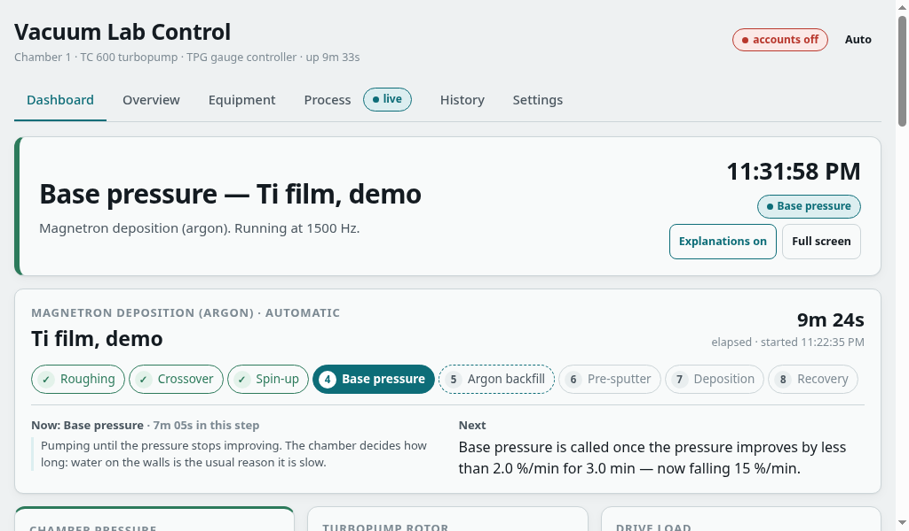

<h1 align="center">Vacuum Lab — control tablet</h1>
<div align="center">

<i>A wiped Android tablet that boots straight into the panel, finds the lab PC over USB or Wi-Fi by itself, keeps its clock from it, and cannot be left without a PIN.</i>

<br><br>


</div>

---

> Part of [Vacuum Lab](../README.md). All paths and commands below are
> relative to this folder: `cd tablet` first.


Turns a Lenovo Tab M7 **TB-7305X** (and a Tab M8 HD **TB-8505X**, see
[below](#second-tablet-tb-8505x-tab-m8-hd)) into a dedicated touch display for the
vacuum-lab control panel (`../control/` in this repository).
The tablet boots straight into the panel, shows nothing else, finds the lab PC
by itself, and can't be exited without a PIN.

```
 lab PC (Ubuntu)                                   tablet (stock Android 9, wiped)
 ┌───────────────────────────┐   USB cable    ┌─────────────────────────────────┐
 │ vacuum-lab-web :8600      │◄──────────────►│ Vacuum Lab kiosk (device owner) │
 │ tablet-link: adb reverse  │  tablet's      │  full-screen WebView (Chrome 138)│
 │   tcp:8600 -> :8600       │  127.0.0.1:8600│  1st: http://127.0.0.1:8600      │
 └───────────────────────────┘                │  2nd: sweep the Wi-Fi /24 :8600  │
              ▲  Wi-Fi fallback (same LAN)    └─────────────────────────────────┘
              └───────────────────────────────────────────────┘
```

<p align="center"><br><i>The Dashboard at the tablet's 1024 × 600, from the simulator.</i></p>

## Why stock Android and not a custom Linux

| Fact (read off this tablet) | Consequence |
| --- | --- |
| SoC MT8765WB = MT6739 family, **32-bit** kernel 4.4 and userspace | No mainline Linux support or postmarketOS port for this chip found. A port would start from Lenovo's 4.4 vendor kernel |
| GPU PowerVR GE8100 | No open-source driver found. Linux would draw the panel on the CPU (4× Cortex-A53 at 1.3 GHz) |
| 1 GB RAM, 16 GB eMMC | Every MB matters; the stock image already has working drivers for all of it |
| Treble, `oem_unlock_supported=1` | Possible in principle. Expect weeks of porting, with Wi-Fi uncertain on these MediaTek ports |
| Chrome 138 WebView with GPU acceleration | Runs the panel today, and will run the React app |

So the tablet keeps Android's kernel and drivers, and everything else is removed
or locked away. The result does what a custom OS would: one app, no
distractions, and Google Play services taken off its 1 GB of RAM.

## What's here

| Path | What |
| --- | --- |
| `kiosk/` | The kiosk app (Java, no AndroidX, ~30 KB APK) |
| `build.sh` | Builds `dist/vacuum-lab-kiosk.apk` with the bare SDK tools; fetches them into `.toolchain/` |
| `provision.sh` | Sets up a wiped tablet: Chrome 138, kiosk as device owner, debloat, settings. `--undo` reverses it |
| `labpc/` | The USB link for the lab PC: `tablet-link.sh`, systemd unit, udev rule, `install.sh` |
| `vendor/chrome-138.0.7204.179/` | Chrome 138 pulled off this tablet before the wipe. **Keep it** (see below) |
| `vendor/webview-155.0.8059.43/` | Android System WebView 155 for the TB-8505X (Android 10+, arm64 + arm) |
| `kiosk/signing/kiosk.keystore` | Signing key. **Keep it**: a device-owner app only accepts updates signed with the same key |

Two files can't be recovered if lost:

- **`vendor/chrome-*`**: a factory reset brings back the system's **Chrome 77**,
  which can't load the panel (its import map needs Chrome 89+). Chrome 138 is
  the last version Google ships for Android 9, and without a Google account
  the tablet can't download it again. `provision.sh` installs it from here.
- **`kiosk/signing/kiosk.keystore`**: without it, the only way to update the
  kiosk is `./provision.sh --undo` followed by provisioning again.

`vendor/webview-*` can be downloaded again (it came from APKMirror; see the
TB-8505X section), but keep it too: provisioning a reset TB-8505X needs it.

## Setting up (once)

### 1. Wipe

1. Settings → Accounts → remove the Google account. A reset done this way
   doesn't trigger Factory Reset Protection.
2. Settings → System → (Advanced) → Reset options → **Erase all data (factory reset)**.

### 2. Setup wizard: skip everything

- Language: any.
- Wi-Fi: join the lab network if you want the Wi-Fi fallback, otherwise skip.
- **Don't sign in to Google** ("Skip"). Android only accepts a device owner on a
  tablet with no accounts.
- Screen lock: **"Not now" / none**.
- Turn off every Google service toggle.

### 3. USB debugging

Settings → About tablet → tap **Build number** 7 times → back → System →
Developer options → **USB debugging** on. Plug the tablet into the computer you provision from
and tap **Allow** on the prompt, with **Always allow from this computer** ticked.

### 4. Provision

```bash
./provision.sh --pin <PIN>
# or, with the lab PC's address as an extra fallback:
./provision.sh --pin <PIN> --urls "http://127.0.0.1:8600, http://<labpc-ip>:8600, lan"
```

If Find My Device is active (it is after a fresh setup), the script opens
Settings → Device admin apps on the tablet and waits: switch Find My Device
off and confirm **Deactivate**. Android doesn't let adb do this, and Google
Play services can't be removed while it's active.

It installs Chrome 138 and the kiosk, makes the kiosk device owner, removes
72 apps (Google Play services included; `--keep-google` leaves them), turns
animations off, keeps the screen on while powered, sets density 160 and media
volume to max, and starts the kiosk. Then reboot once (`adb reboot`) to check
that the tablet comes straight back to the panel.

### Verified on this tablet (2026-10-10, after the wipe)

| Check | Result |
| --- | --- |
| Boot to panel | 44 s to Android, panel connected 5 s later |
| Lock | lock task LOCKED after reboot; Home and Recents don't leave the panel; status bar disabled |
| Debloat | 165 → 92 enabled packages; free memory 296 → 438 MB; swap in use ~527 → 104 MB |
| Server lost / back | cover within 15 s, panel reloads when the server answers |
| Wi-Fi fallback | USB gone: found the panel on the /24 in 6 s. USB back: switched to it in 16 s |
| Clock | set from the server's `Date` header to the second, both forwards and back |
| Admin menu | 5 corner taps → PIN (keyboard's ✓ submits) → menu, system bars stay hidden |

Not verified yet: Lenovo battery protection actually holding the charge
around 60 % (check after a day plugged in), and the lab PC side (`labpc/`).

### 5. Lab PC

```bash
labpc/install.sh user@labpc
```

This copies `adb` (the lab PC is offline), the provisioning computer's adb key (the
one the tablet trusts) and the link script into `~/vacuum-lab-tablet/`, then installs
the udev rule and the `tablet-link` service. Plug the tablet into the lab PC;
within ~5 s the kiosk shows the panel. `journalctl -u tablet-link` shows the
forwarding.

## Second tablet: TB-8505X (Tab M8 HD)

Provisioned 2026-10-13 with the same script, PIN and server list as the
TB-7305X: `./provision.sh --pin <PIN> --urls "http://127.0.0.1:8600,
http://<labpc-ip>:8600, lan:<labpc-subnet>"`. It needs no wipe step if it has
no accounts. What differs:

| | TB-7305X | TB-8505X |
| --- | --- | --- |
| Android | 9, 32-bit | 10, 64-bit (MT6761, 4× A53 @ 2.0 GHz, 1.75 GB) |
| Web engine | Chrome 138 (Chrome *is* the WebView) | **Android System WebView 155**. Android 10 won't take Chrome as the WebView, and the image ships WebView 81 |
| Density / viewport | 160 → 1024 × 600 at DPR 1 | 200 → **1024 × 640 at DPR 1.25** (stock 240 would give 853 × 533) |
| USB vendor in Android | MediaTek `0e8d` | Lenovo `17ef` (the udev rule has both) |

The WebView APK in `vendor/` is Google's 155.0.8059.43 stable build, variant
"arm64-v8a + armeabi-v7a, Android 10+", from APKMirror. Before installing,
`apksigner verify --print-certs` showed the same certificate as the system
WebView (CN=webview, O=Google Inc., SHA-256 `6faf3c41…72ba6fe5`). Android
refuses the update otherwise. `provision.sh` installs it when the tablet's
WebView is older. To move to a newer one, download that variant, check the
certificate the same way, and swap the folder.

### Verified (2026-10-13)

| Check | Result |
| --- | --- |
| Boot to panel | 40 s to Android, kiosk in front at 43 s, LOCKED; panel 6 s after the USB link |
| Debloat | 202 → 144 enabled packages (59 removed); kiosk uses ~100 MB |
| `uitest --attach` (simulator over USB) | 44/50 in 14 s. The 6 failures are regular buttons measuring 39.3 px (limit 39.5); see the note on borders below |

The 6 touch-size failures: at DPR 1.25 Chrome draws each 1 px border as one
device pixel, which is 0.8 CSS px, so a `button`/`.btn` (8 + 21.7 + 8 px plus
borders) comes to 39.3 instead of 39.7. Physically they are 6.6 mm tall,
larger than the 5.9 mm that passes on the TB-7305X. Giving `button, .btn`
`min-height: 40px` in the panel's `@media (pointer: coarse)` block would make
the check pass at any density.

## Day to day

- **Admin menu**: tap the top-left corner 5 times quickly, then enter the PIN.
  The menu has: reload the panel, search for the server again, Wi-Fi settings,
  Android settings, and connection details. Leaving for Settings unlocks the
  kiosk; going back home locks it again.
- **Server down / cable out**: within 15 s the panel is covered by a dark
  screen listing what was tried. The kiosk keeps searching every 2 s and
  reloads the panel when the server answers.
- **Wi-Fi fallback**: if the USB link isn't there, the kiosk sweeps the /24
  the tablet is on for port 8600 every 20 s and recognises the panel by
  `/api/ping` containing `vacuum-lab`. While it shows the panel over Wi-Fi, it
  checks every 30 s whether USB is back and switches to it. The
  word `lan` in `urls` sweeps the tablet's own /24; `lan:a.b.c` sweeps
  a.b.c.0/24 instead -- for a lab PC on another subnet than the tablet's
  Wi-Fi. In the lab the tablets' Wi-Fi is on another subnet, so they are set
  to `http://127.0.0.1:8600, http://<labpc-ip>:8600, lan:<labpc-subnet>`: the
  USB link, then the lab PC's address, then a sweep of the lab PC's subnet in
  case that address moves.
- **After a deploy** the panel reloads itself within a poll or two. To force
  a reload from the lab PC:
  `ssh user@labpc '~/vacuum-lab-tablet/tablet-link.sh reload'`.
- **Clock**: the lab is offline, so the tablet takes its time from the lab
  PC's HTTP `Date` header whenever they differ by 5 s or more. Before the wipe
  it believed it was 2009, which breaks the panel's alarm ages and
  operator-prompt timers.
- **Pairing**: an admin pairs each tablet once (in the panel, Settings →
  People → Tablets gives a one-time code, typed into *Pair this tablet*). A
  paired tablet shows the rig and sounds alarms with nobody signed in, and can
  never act. The USB origin (`127.0.0.1:8600`) and a Wi-Fi origin
  (`<labpc-ip>:8600`) are different origins, so each is paired separately.
- **Alarm sound**: the panel creates its AudioContext on the first touch. The
  kiosk sends one cancelled touch after each load, so alarms are audible even
  if nobody has touched the tablet.
- **Debugging the page**: with the tablet on adb, open `chrome://inspect` in
  Chrome on the laptop to get the panel's console and DevTools.

### Changing the kiosk's settings without touching the tablet

```bash
adb shell am broadcast -n lab.vacuum.kiosk/.ConfigReceiver -a lab.vacuum.kiosk.CONFIGURE \
    --es urls "http://127.0.0.1:8600, lan" --es pin <PIN> --ei text_zoom 110
```

Extras: `urls`, `pin`, `lan_port`, `text_zoom`, `orientation`
(landscape|portrait|auto), `wake_audio`, `timezone`, `reset`, `release`. The
reply prints the resulting configuration. Only the adb shell can send it (the
receiver requires the `DUMP` permission).

### Updating the kiosk

```bash
./build.sh && .toolchain/platform-tools/adb install -r dist/vacuum-lab-kiosk.apk
```

The app restarts itself after the update.

## Undo

```bash
./provision.sh --undo      # releases device owner, uninstalls the kiosk, restores the apps
```

A factory reset also brings the tablet back to stock. If the kiosk ever stops
working and adb isn't available: hold Power + Volume up (the usual Lenovo combination) to reach recovery, then
choose wipe data/factory reset.

## For the React rewrite: what this tablet is

Measured on this tablet with the current Preact panel (simulated rig, USB link):

| | |
| --- | --- |
| Engine | Chrome 138 WebView. **Frozen there**: Android 9 gets no newer Chrome. ES2023, import maps, container queries, `:has()` all work |
| Viewport | **1024 × 600 CSS px at DPR 1** (density 160), landscape. Plan for this, not a desktop. The TB-8505X gives 1024 × 640 at DPR 1.25 with WebView 155 |
| CPU | 4× Cortex-A53 @ 1.3 GHz, 32-bit. The dashboard at idle uses **~0.85 of one core**, and redraws after each 2 s poll take **up to ~150 ms** |
| RAM | 1 GB total; the kiosk process uses ~95–140 MB |
| Motion | Animations are off system-wide, so Chrome reports `prefers-reduced-motion: reduce` |

What helps most on this hardware:

- Long series on `<canvas>` (or SVG with decimated points); avoid re-rendering
  the whole tree on each poll. Memoize the chart components so only the series
  that changed redraws.
- No `backdrop-filter`, large blurs or big box-shadows: those cost the most on
  a GE8100.
- Touch targets ≥ 40 px; no hover-only affordances. Set it with
  `min-height` rather than padding + line height + border: on the TB-8505X
  (DPR 1.25) a 1 px border is drawn as 0.8 CSS px.
- Keep **`GET /api/ping`** unauthenticated and keep `"service": "vacuum-lab"`
  in its reply: that's how the kiosk recognises the panel.
- Downloads (CSV export) can't be saved on the tablet: the kiosk shows a toast.
- Element fullscreen works (the dashboard's wall mode).

## Troubleshooting

| Symptom | Cause / fix |
| --- | --- |
| Cover says "USB link: no answer" while plugged in | `tablet-link` isn't forwarding: `systemctl status tablet-link` on the lab PC. "has not authorised this PC's adb key" means `~/vacuum-lab-tablet/adbkey` isn't the provisioning key |
| Blank or broken panel after a factory reset | The old engine is back (Chrome 77 on the TB-7305X, WebView 81 on the TB-8505X): run `./provision.sh` again, it reinstalls the one from `vendor/` |
| `dpm set-device-owner` fails: "already some accounts" | An account is on the tablet: remove it, or wipe again and skip the Google sign-in |
| Wi-Fi fallback never finds the panel | A firewall on the server drops port 8600 (ufw does, by default). The lab PC has to accept 8600 from the tablet |
| Nothing at all on screen | Hold Power for 10 s to force a restart; the tablet boots into the kiosk |
